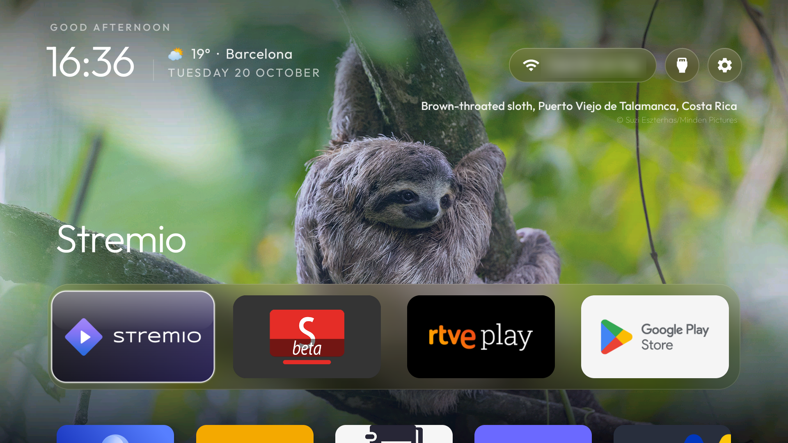

<h1 align="center">CleanXiaomiTV 4A</h1>

<p align="center">A Xiaomi Mi TV 4A (MiTV-MOOQ1) without the ads and the lag: debloat list, a clean launcher, the weather, and an Input button that works like stock.</p>



**Built and tested on** a Xiaomi Mi TV 4A, MiTV-MOOQ1 (tarzan), Android TV 10, MediaTek MT9632, 1.8 GB RAM, 1080p.
Should work on other PatchWall-era Xiaomi Android TVs with the same chassis (MOOQ0 and friends); check the package list first.

Based on [CleanXiaomiTV](https://github.com/majnioui/CleanXiaomiTV) by majnioui, which is built on [CleanYourTV](https://github.com/Gathin23/cleanyourtv) by Gathin.

## What's different from CleanXiaomiTV

- **Input button works like stock.** On this TV the remote sends `KEYCODE_TV_INPUT` (178), and Xiaomi's `partnercustomizer` opens the stock launcher's inputs panel for it. Disable the stock launcher and the button does nothing. Here the launcher's accessibility service catches the key and opens a **side panel styled after the stock one**, over whatever is playing: TV, HDMI ports with their device names (e.g. "Apple TV · HDMI 3"), AV. No trip through the home screen.
  Prefer CleanYourTV's dropdown under the Inputs pill? Set `inputs_sidebar` to `false`.
- **Debloat list for MOOQ1** in [`debloat.txt`](debloat.txt), with what must stay (Bluetooth remote pairing, HDMI window, voice, Chromecast) and why.
- **Removed:** the athkar on the screensaver, the Solar Hijri date, and the Prayer Times and Moroccan Channels apps.
- **Defaults:** weather for Barcelona, a dock of Stremio, SmartTube, RTVE Play and Play Store, Live TV pointed at MediaTek's `com.mediatek.wwtv.tvcenter`.
- Own app id `com.pavelpulso.cleanxiaomitv4a`, so it installs next to the original without clashing.

Kept from upstream: the photo of the day behind the home screen, glass buttons, hold OK on a tile to move it, the clock screensaver with photos, the Weather app card, themes.

## Install

On the TV: Settings → Device Preferences → About → press OK on **Build** seven times, then Developer options → **USB debugging** on.

You need JDK 17 and the Android SDK, or just Docker:

```bash
# build without installing anything locally
docker run --rm -v "$PWD/launcher":/src -v cyt-gradle:/root/.gradle -v cyt-android:/root/.android -w /src \
  ghcr.io/cirruslabs/android-sdk:34 sh -c 'echo sdk.dir=$ANDROID_HOME > local.properties; ./gradlew assembleRelease'
```

Keep the `cyt-android` volume: it holds the debug signing key, and a new key means uninstalling before the next update.

Then, on a computer on the same Wi-Fi:

```bash
python3 -m venv tools/venv && tools/venv/bin/pip install -r tools/requirements.txt
export TV_HOST=192.168.1.50                         # your TV's IP; accept "Allow USB debugging?" on the TV

tools/disable.sh debloat.txt                         # debloat (wait ~10 s before any reboot, see below)
INPUT_KEY_SERVICE=1 launcher/build-and-install.sh    # the launcher, made the default Home
```

`INPUT_KEY_SERVICE=1` is what keeps the Input button alive. Android switches accessibility services off on every reinstall, so pass it each time. The installer also points Private DNS at AdGuard; `PRIVATE_DNS=off` skips that.

## Configure

[`launcher/app/src/main/res/values/config.xml`](launcher/app/src/main/res/values/config.xml): dock apps, hidden apps, the weather coordinates, `inputs_sidebar`, `home_photo`, `dream_photos`, `now_playing`, `grid_columns`. Rebuild, or push a `config.json` with the same keys from [`themes/`](themes/) without rebuilding.

## Gotchas found on this TV

- `pm disable-user` is written to disk about 10 seconds later. Reboot right after and the packages come back enabled, which looks like the firmware fighting you. It isn't.
- `com.google.android.tvlauncher` answers Home at priority 2. While it is enabled Android picks it over any preferred Home, and the shell can't disable just its Home activity. So the stock inputs panel and a custom launcher can't coexist without root, hence the side panel.
- `com.xiaomi.android.tvsetup.partnercustomizer` looks like bloat but pairs the Bluetooth remote and routes the Input key. Keep it.
- HbbTV runs as a vendor daemon (`hbbtv_content_shell`), not a package; it can't be disabled without root.

## Undo

```bash
TV_HOST=192.168.1.50 tools/restore.sh debloat.txt com.google.android.tvlauncher
```

Re-enables everything in the list, gives Home back to the stock launcher and switches the AdGuard DNS off. Remove the launcher in Settings → Apps if you like.

## Network

No analytics, no accounts. Requests go to [Open-Meteo](https://open-meteo.com) for the weather (only the configured coordinates), Bing's photo of the day archive, and AdGuard as the DNS resolver. Each can be switched off in `config.xml`.

## Credits

[CleanXiaomiTV](https://github.com/majnioui/CleanXiaomiTV) by majnioui, built on [CleanYourTV](https://github.com/Gathin23/cleanyourtv) by [Gathin](https://github.com/Gathin23). MIT licensed, see [`LICENSE`](LICENSE). Font: Outfit (OFL). Icons: Material (Apache 2.0), Feather (MIT), Lucide (ISC).
