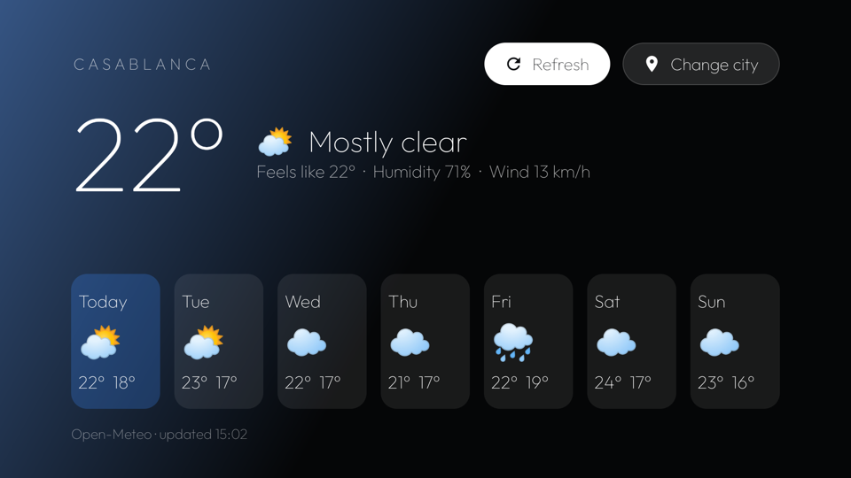

# Modules

A small Android TV app that shows up on the home screen as a **module card**
(see [`docs/modules.md`](../docs/modules.md)). About 170 KB.
It doesn't run in the background and uses the network only to fetch the forecast.



**Weather**: today and a 7-day forecast from [Open-Meteo](https://open-meteo.com). **Change city** searches any city with the remote; **Refresh** reloads.

## Install

From the repo root, with the TV's IP:

```bash
cd modules && ./gradlew assembleRelease && cd ..
for m in weather; do
  TV_HOST=192.168.1.50 tools/venv/bin/python -I tools/b64push.py modules/$m/build/outputs/apk/release/$m-release.apk /data/local/tmp/$m.apk
  TV_HOST=192.168.1.50 tools/venv/bin/python -I tools/tv.py "pm install -r /data/local/tmp/$m.apk; rm -f /data/local/tmp/$m.apk"
done
```

Press Home and the launcher asks once whether to show its card. Hold OK on Settings → Module cards to
change your answer.

The default city is Barcelona: `latitude`, `longitude` and `place` in `weather/src/main/res/values/config.xml`.
The app remembers whatever you pick with Change city.

Icons: [Material](https://fonts.google.com/icons) (Apache 2.0), [Feather](https://feathericons.com) (MIT) and
[Lucide](https://lucide.dev) (ISC). Font: Outfit (OFL, `FONT-LICENSE-OFL.txt`).
